# Análise dos experimentos few-shot DGCG

Abra `relatorio.html` para o relatório completo, com explicações, tabelas e filtros. Ele funciona offline; todos os gráficos estão embutidos.

Foram analisadas 1332 observações válidas após remover 270 duplicações. Há 28 ajustes incompletos em Plant Village.

```text
        metodo   n  media_val  media_teste  media_loss  media_gap
        knn-in 270     77.630       74.192       0.637      3.438
       knn-out 270     78.443       75.230       0.613      3.213
knn-reciprocal 270     79.162       75.623       0.594      3.539
          dgcg 270     79.274       76.047       0.596      3.227
```

Melhor alvo comum por validação: densidade 0.125, validação 67.74%, teste 62.64%. Baseline 4–6 teste 62.35%.
Ganho médio de ajuste por base selecionado pela validação: -0.02 pp. Ganho em transferência leave-one-dataset-out: -0.02 pp.

## Limites das conclusões
Uma rodada por configuração. IC original mede episódios, não seeds. Densidade realizada não foi registrada. Comparações entre n-way mudam a tarefa. Sem predições individuais não é possível avaliar calibração ou confusão de classes. Grau/densidade foram ajustados só em 5-way/1-shot/5-query.

## Gráficos

### Médias da grade e sensibilidade aos episódios pequenos
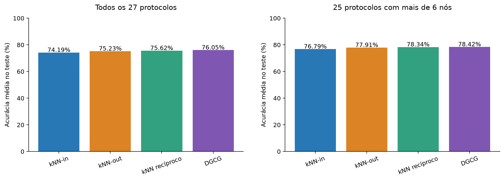
As barras são médias descritivas da grade, sem IC por treinamento. Não são resultados de um único protocolo.

### Onde cada método funciona melhor
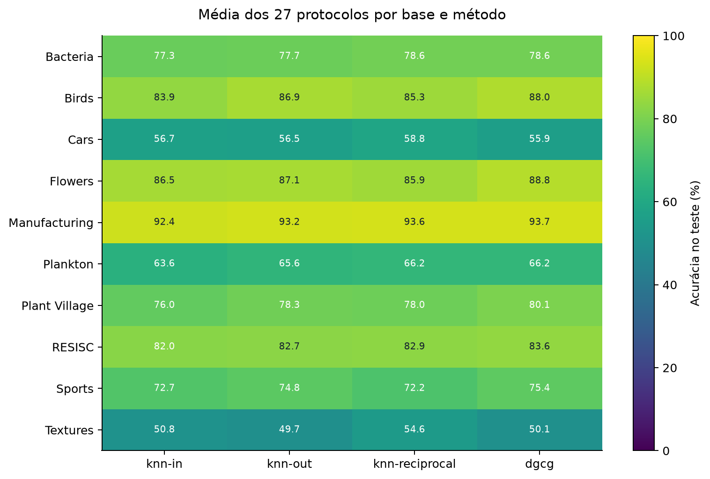
Compare os métodos dentro da mesma linha. Bases diferentes têm classes e dificuldades diferentes.

### Ganhos e perdas em relação ao kNN-in
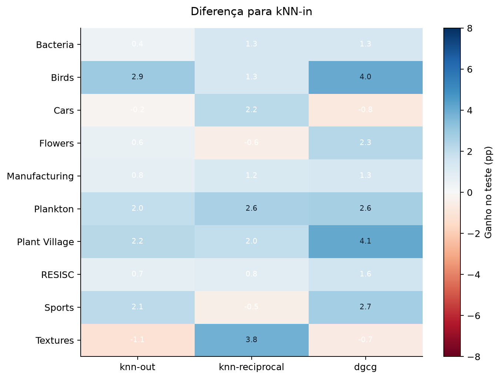
Valores positivos favorecem o método da coluna. Cada célula usa a mesma base e os mesmos 27 protocolos.

### Comparação no protocolo default
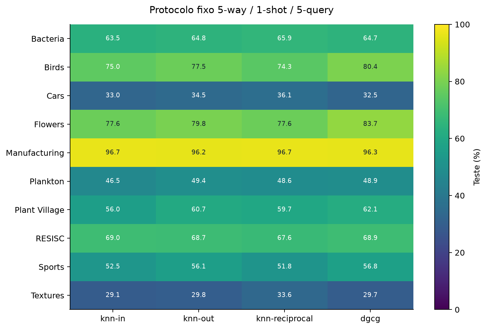
Esta comparação elimina a mistura entre protocolos. Cada valor é o teste de um checkpoint escolhido pela validação.

### Resultado depois da escolha de protocolo por validação
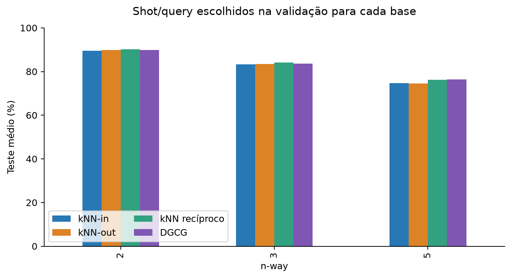
Cada método/base/n-way escolhe o shot/query de maior validação; desempate por menor loss de validação. O teste é consultado depois da escolha.

### Todas as combinações shot/query em 2-way
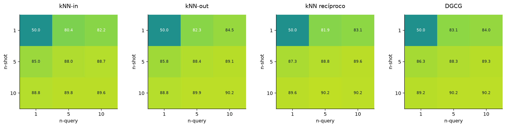
Cada célula é a média de dez bases. Maior suporte/query usa mais informação; não representa ganho gratuito com o mesmo orçamento.

### Todas as combinações shot/query em 3-way
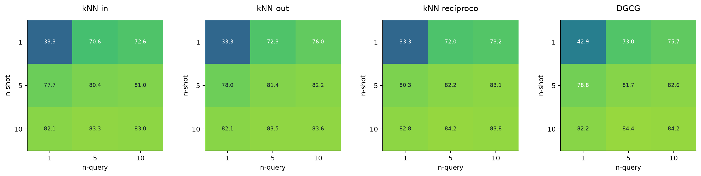
Cada célula é a média de dez bases. Maior suporte/query usa mais informação; não representa ganho gratuito com o mesmo orçamento.

### Todas as combinações shot/query em 5-way
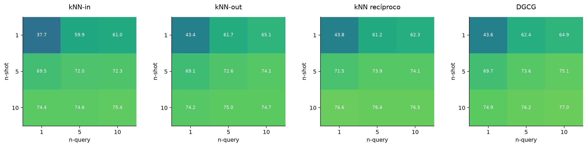
Cada célula é a média de dez bases. Maior suporte/query usa mais informação; não representa ganho gratuito com o mesmo orçamento.

### Efeito de n_shot
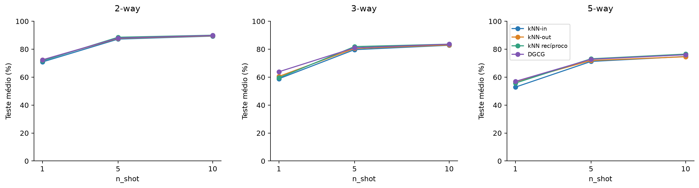
Médias balanceadas sobre os outros parâmetros e datasets; o treinamento também muda com o protocolo. Query tem efeito transdutivo porque participa do grafo.

### Efeito de n_query
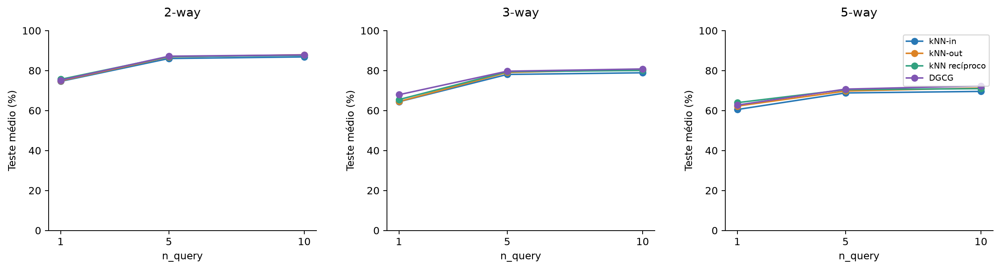
Médias balanceadas sobre os outros parâmetros e datasets; o treinamento também muda com o protocolo. Query tem efeito transdutivo porque participa do grafo.

### Diferenças entre classes de validação e de teste
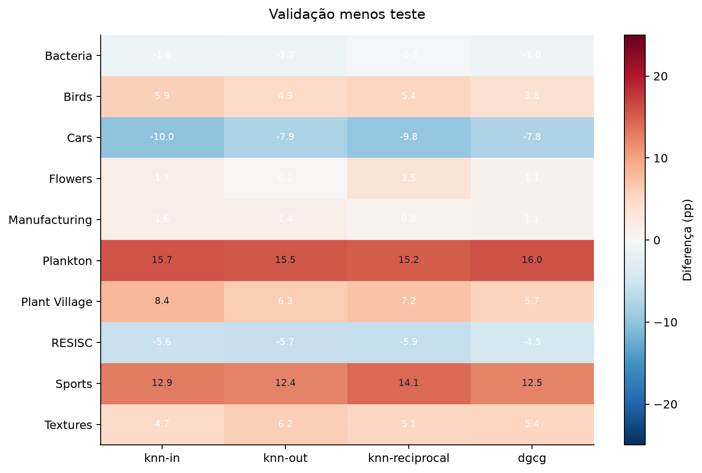
Gap positivo significa validação mais fácil ou mais otimista que o teste. As classes são disjuntas: este gap, sozinho, não prova overfitting.

### Loss, acurácia e diferenças entre splits
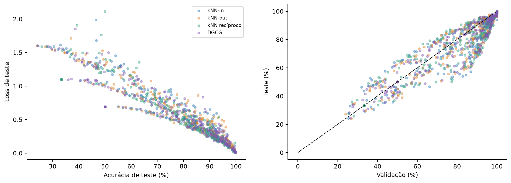
Loss depende das probabilidades/confiança, além dos acertos. Estes CSVs não contêm probabilidades suficientes para avaliar calibração diretamente.

### Resposta média do DGCG ao grau e à densidade
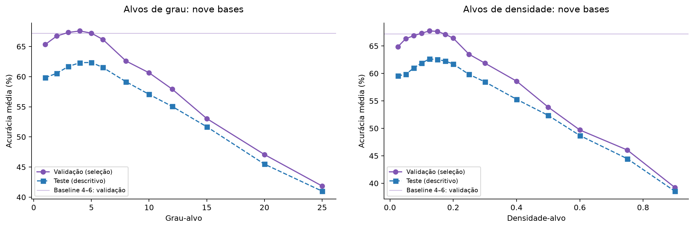
Compare validação para escolher o alvo. Alvos grandes podem aumentar mistura entre classes; alvos pequenos podem reduzir troca de informação.

### Sensibilidade de grau em cada dataset
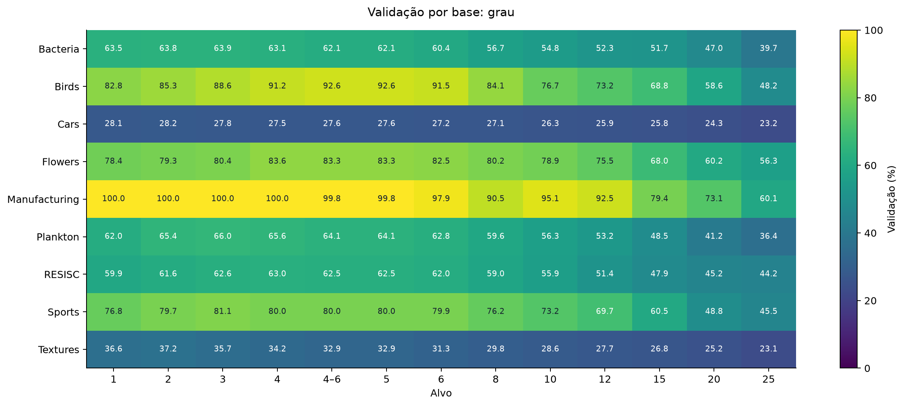
Plant Village está ausente porque todas as suas 28 execuções de ajuste estão incompletas.

### Sensibilidade de densidade em cada dataset
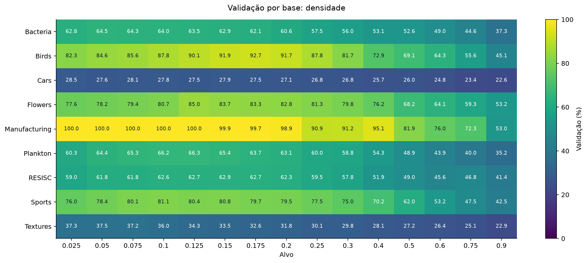
Plant Village está ausente porque todas as suas 28 execuções de ajuste estão incompletas.

### Quanto o ajuste realmente acrescentou no teste
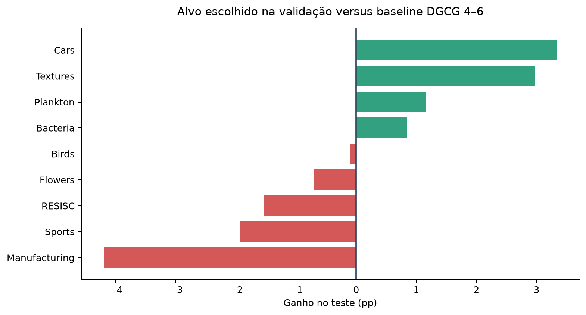
Todos os ganhos usam o baseline da mesma rodada e o mesmo protocolo. Nenhum alvo foi escolhido pelo teste.

### DGCG ajustado e as baselines no mesmo protocolo
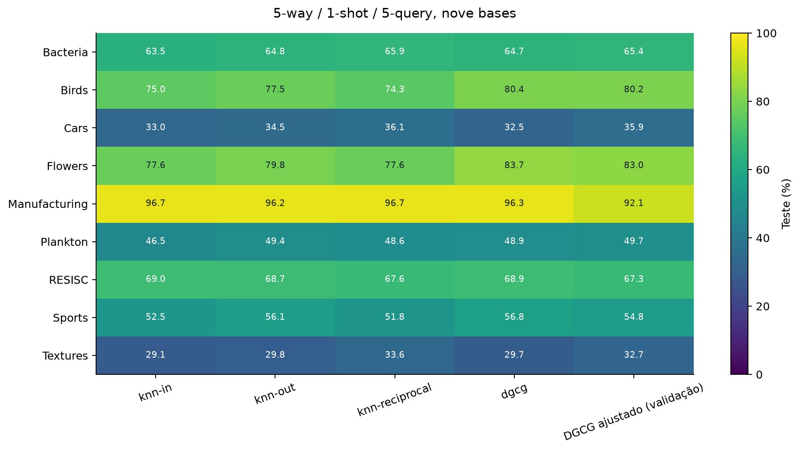
O DGCG ajustado vem de outra rodada: pequenas diferenças de execução existem. Esta comparação é descritiva; ganho de ajuste deve ser medido contra 4–6 da própria rodada.

### Dossiê Bacteria: todos os protocolos
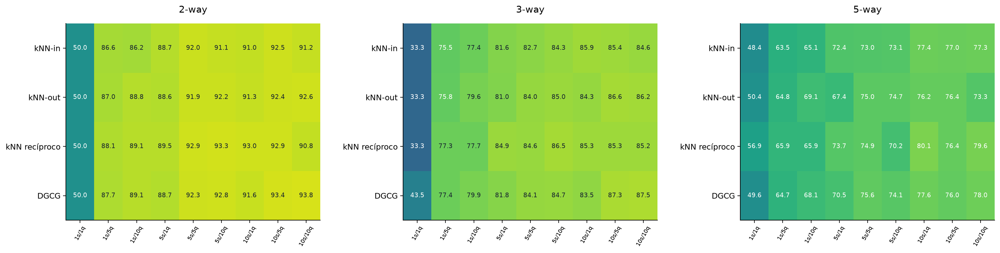
s = shot, q = query. Cada painel compara métodos dentro do mesmo n-way. Os números são teste (%).

### Dossiê Birds: todos os protocolos
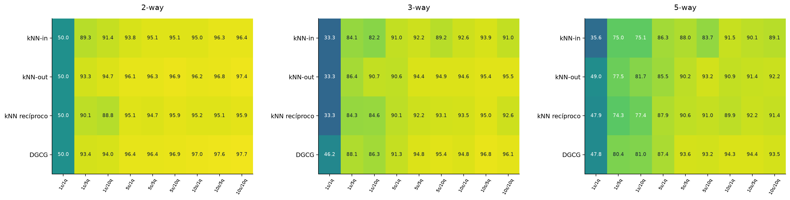
s = shot, q = query. Cada painel compara métodos dentro do mesmo n-way. Os números são teste (%).

### Dossiê Cars: todos os protocolos
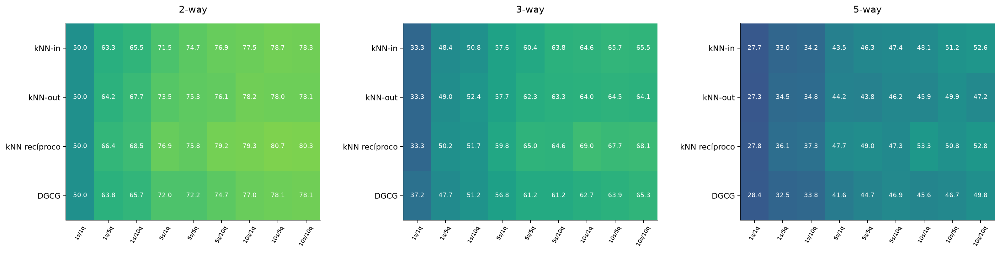
s = shot, q = query. Cada painel compara métodos dentro do mesmo n-way. Os números são teste (%).

### Dossiê Flowers: todos os protocolos
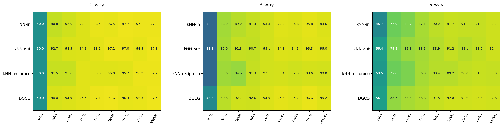
s = shot, q = query. Cada painel compara métodos dentro do mesmo n-way. Os números são teste (%).

### Dossiê Manufacturing: todos os protocolos
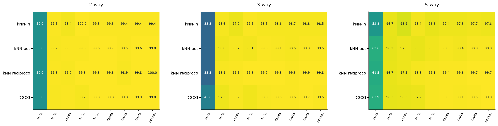
s = shot, q = query. Cada painel compara métodos dentro do mesmo n-way. Os números são teste (%).

### Dossiê Plankton: todos os protocolos
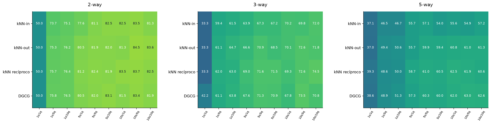
s = shot, q = query. Cada painel compara métodos dentro do mesmo n-way. Os números são teste (%).

### Dossiê Plant Village: todos os protocolos
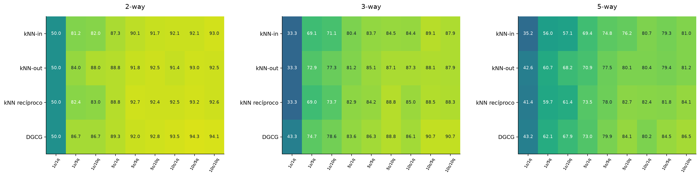
s = shot, q = query. Cada painel compara métodos dentro do mesmo n-way. Os números são teste (%).

### Dossiê RESISC: todos os protocolos
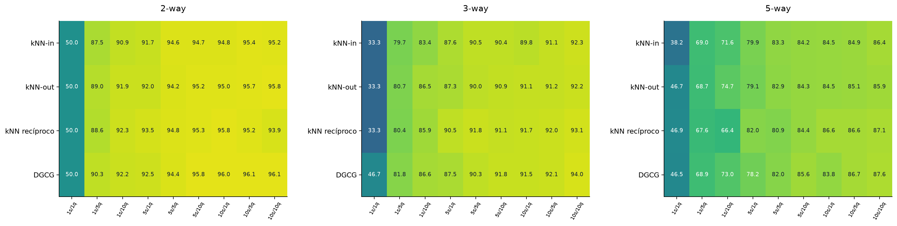
s = shot, q = query. Cada painel compara métodos dentro do mesmo n-way. Os números são teste (%).

### Dossiê Sports: todos os protocolos
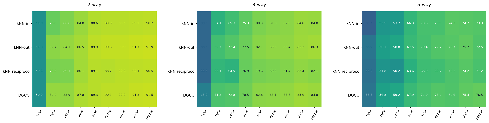
s = shot, q = query. Cada painel compara métodos dentro do mesmo n-way. Os números são teste (%).

### Dossiê Textures: todos os protocolos
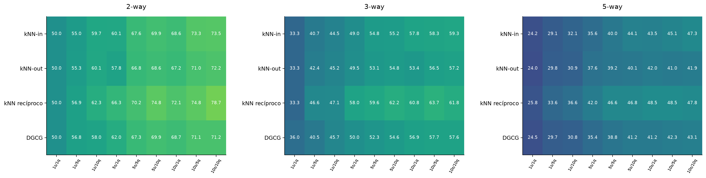
s = shot, q = query. Cada painel compara métodos dentro do mesmo n-way. Os números são teste (%).

### Comparar desempenho com o orçamento de imagens
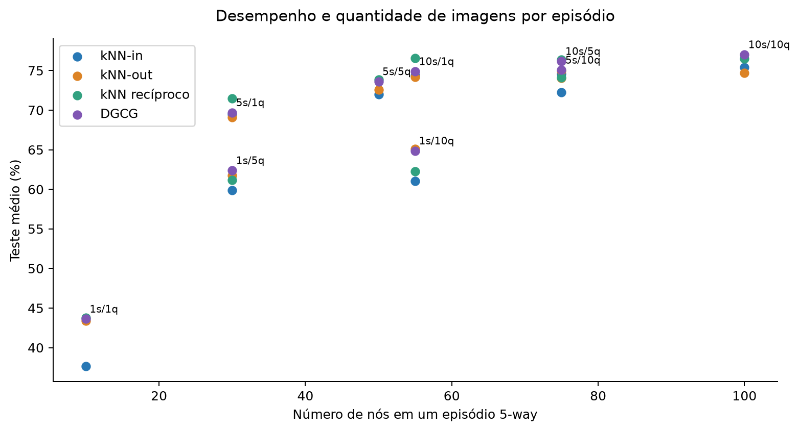
Protocolos com mais imagens tendem a resolver tarefas mais informadas. Número de nós não substitui tempo medido: custo da ordenação/propagação depende do método e da implementação.
